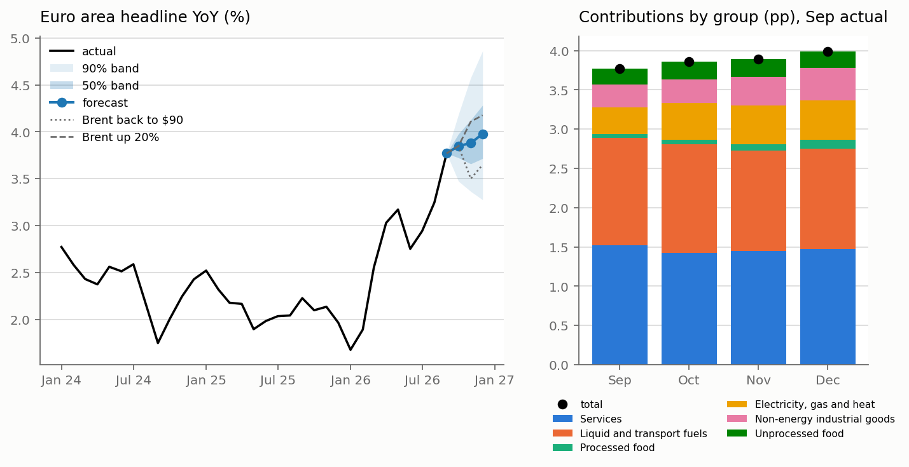

# Forecast, October to December 2026

Made as of 20 October 2026: HICP to 2026-09, Brent to 2026-10-14, pump prices to 2026-10-12, surveys to 2026-09. Model: Bottom-up ridge, picked in `forecast_evaluation.md`. Bands come from its past errors.

| month | YoY % | 50% band | 90% band | base effect since Sep (pp) | new months since Sep (pp) |
|---|---|---|---|---|---|
| Oct 2026 | 3.85 | 3.7 to 4.0 | 3.5 to 4.2 | -0.23 | 0.31 |
| Nov 2026 | 3.88 | 3.7 to 4.1 | 3.4 to 4.6 | 0.07 | 0.04 |
| Dec 2026 | 3.98 | 3.7 to 4.3 | 3.3 to 4.9 | -0.11 | 0.32 |

From 3.77% in September: the months dropping out of the comparison add -0.11 pp by December and the new months +0.32 pp.

Contributions by group (pp); September is actual, the rest forecast:

| month | Services | Liquid and transport fuels | Processed food | Electricity, gas and heat | Non-energy industrial goods | Unprocessed food |
|---|---|---|---|---|---|---|
| Sep 2026 | 1.52 | 1.37 | 0.05 | 0.34 | 0.29 | 0.21 |
| Oct 2026 | 1.42 | 1.38 | 0.06 | 0.46 | 0.30 | 0.22 |
| Nov 2026 | 1.45 | 1.28 | 0.08 | 0.49 | 0.37 | 0.22 |
| Dec 2026 | 1.47 | 1.28 | 0.11 | 0.49 | 0.42 | 0.21 |

Oil scenarios (YoY %). Brent moves from the second half of the coming month, pump prices follow with the pass-through estimated since 2005. The first month doesn't move: the model reads it off the first two weeks of pump prices, which are already in.

| scenario | Brent ($) | Oct | Nov | Dec |
|---|---|---|---|---|
| Brent flat | 127 | 3.85 | 3.88 | 3.98 |
| Brent back to $90 | 90 | 3.85 | 3.50 | 3.65 |
| Brent up 20% | 153 | 3.85 | 4.11 | 4.18 |

All models (YoY %):

| model | Oct | Nov | Dec |
|---|---|---|---|
| No change | 3.77 | 3.77 | 3.77 |
| Seasonal | 3.90 | 3.90 | 3.90 |
| Direct regression | 3.85 | 3.92 | 4.08 |
| Bottom-up | 3.80 | 3.81 | 3.95 |
| Average | 3.83 | 3.87 | 4.01 |
| Bottom-up ridge | 3.85 | 3.88 | 3.98 |

Q4 average 3.90%. For reference, ECB staff projections (September 2026): 3.6% in Q4 2026, with oil at about $88.

