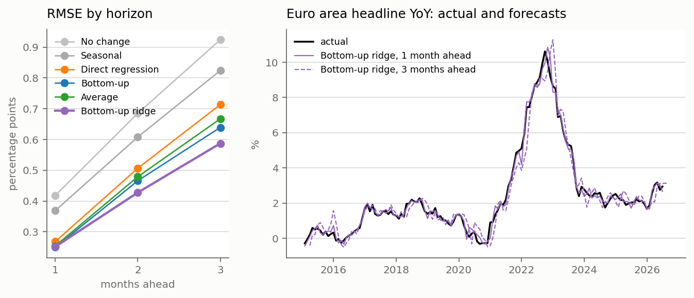

# Forecast evaluation

Built by `python -m src evaluate`. 138 origins, 2015-01 to 2026-06, every model scored on the same months against YoY from today's index.

## Accuracy

| model | h | RMSE | MAE | bias | RMSE / no change | DM p vs no change |
|---|---|---|---|---|---|---|
| No change | 1 | 0.418 | 0.297 | -0.026 | 1.000 | - |
| No change | 2 | 0.685 | 0.487 | -0.051 | 1.000 | - |
| No change | 3 | 0.924 | 0.672 | -0.079 | 1.000 | - |
| Seasonal | 1 | 0.369 | 0.245 | -0.070 | 0.882 | 0.214 |
| Seasonal | 2 | 0.608 | 0.408 | -0.139 | 0.888 | 0.342 |
| Seasonal | 3 | 0.824 | 0.543 | -0.209 | 0.892 | 0.454 |
| Direct regression | 1 | 0.268 | 0.191 | 0.018 | 0.642 | 0.002 |
| Direct regression | 2 | 0.507 | 0.378 | 0.012 | 0.740 | 0.021 |
| Direct regression | 3 | 0.713 | 0.528 | 0.006 | 0.772 | 0.049 |
| Bottom-up | 1 | 0.250 | 0.172 | -0.024 | 0.597 | 0.001 |
| Bottom-up | 2 | 0.466 | 0.331 | -0.061 | 0.680 | 0.009 |
| Bottom-up | 3 | 0.639 | 0.462 | -0.096 | 0.692 | 0.017 |
| Average | 1 | 0.254 | 0.178 | -0.003 | 0.607 | 0.001 |
| Average | 2 | 0.479 | 0.351 | -0.024 | 0.699 | 0.012 |
| Average | 3 | 0.667 | 0.486 | -0.045 | 0.722 | 0.026 |
| Bottom-up ridge | 1 | 0.252 | 0.176 | 0.007 | 0.602 | 0.001 |
| Bottom-up ridge | 2 | 0.428 | 0.301 | -0.008 | 0.624 | 0.006 |
| Bottom-up ridge | 3 | 0.587 | 0.415 | -0.026 | 0.636 | 0.007 |

Bottom-up ridge has 40% lower RMSE than no change one month ahead. Against Bottom-up, the runner-up, DM p-values by horizon are 0.90, 0.18, 0.21.

## Model choice

Rule, set before the backtest ran: lowest RMSE averaged over the three horizons, and a simpler model within 2% of the best one wins. Order, simplest first: No change, Seasonal, Direct regression, Bottom-up, Average, Bottom-up ridge.

| model | avg RMSE |
|---|---|
| No change | 0.676 |
| Seasonal | 0.600 |
| Direct regression | 0.496 |
| Bottom-up | 0.452 |
| Average | 0.467 |
| Bottom-up ridge | 0.422 |

Chosen: **Bottom-up ridge**.

## By period

Average RMSE over the three horizons, by target year:

| model | 2015-19 | 2020-23 | 2024-26 |
|---|---|---|---|
| No change | 0.369 | 1.024 | 0.381 |
| Seasonal | 0.311 | 0.925 | 0.308 |
| Direct regression | 0.330 | 0.704 | 0.345 |
| Bottom-up | 0.300 | 0.646 | 0.303 |
| Average | 0.312 | 0.665 | 0.315 |
| Bottom-up ridge | 0.247 | 0.615 | 0.302 |

## Against the first release

Same scores against YoY as first published (one decimal), average over horizons: No change 0.681, Seasonal 0.604, Direct regression 0.501, Bottom-up 0.456, Average 0.471, Bottom-up ridge 0.425.

## What each source adds

Change in RMSE (%) when one source is blanked out, averaged over the horizons. Positive means the forecast gets worse without it.

| without | Average | Bottom-up | Bottom-up ridge | Direct regression |
|---|---|---|---|---|
| no_brent | +0.7 | +1.4 | +1.2 | +0.0 |
| no_bulletin | +6.8 | +4.4 | +8.0 | +11.8 |
| no_gas | -0.4 | -0.8 | -2.1 | +0.0 |
| no_surveys | +5.3 | +3.2 | +10.8 | +6.1 |

## Intervals

Quantiles of Bottom-up ridge's last 120 out-of-sample errors at each horizon, using only errors whose outcome was out at the time. Real-time coverage (%):

| level | h | coverage | excl. 2021-23 | 2021-23 | width (pp) | n |
|---|---|---|---|---|---|---|
| 50% | 1 | 47.8 | 54.9 | 27.8 | 0.25 | 138 |
| 50% | 2 | 43.5 | 52.0 | 19.4 | 0.41 | 138 |
| 50% | 3 | 40.6 | 48.0 | 19.4 | 0.49 | 138 |
| 90% | 1 | 86.2 | 93.1 | 66.7 | 0.68 | 138 |
| 90% | 2 | 86.2 | 94.1 | 63.9 | 1.04 | 138 |
| 90% | 3 | 79.7 | 88.2 | 55.6 | 1.36 | 138 |

Close to nominal outside 2021-23 (93, 94, 88 for the 90% band), far too narrow during the surge (67, 64, 56): the errors before it gave no warning.

