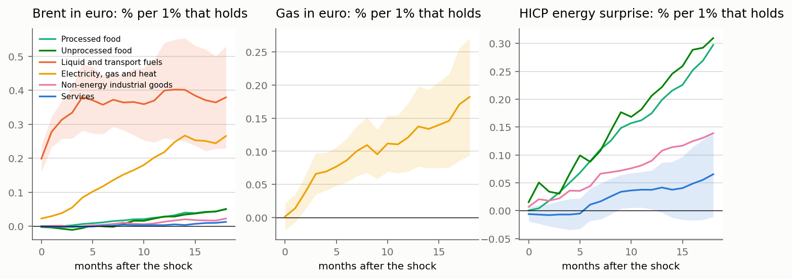

# Pass-through

Local projections, monthly, euro area. % change in each group's level h months after a 1% rise in the shock variable that holds. 3 lags, month dummies, Newey-West. The last column re-estimates without 2020 to 2023.

### brent

| group | h=1 | h=3 | h=6 | h=12 | h=18 | h=12 ex 2020-23 |
|---|---|---|---|---|---|---|
| Processed food | -0.000 | 0.002 | 0.011 | 0.027 | 0.051 | 0.009 |
| Unprocessed food | -0.004 | -0.011 | -0.001 | 0.028 | 0.050 | 0.016 |
| Liquid and transport fuels | 0.278 | 0.334 | 0.357 | 0.399 | 0.379 | 0.380 |
| Electricity, gas and heat | 0.029 | 0.055 | 0.117 | 0.218 | 0.265 | 0.128 |
| Non-energy industrial goods | 0.001 | -0.003 | 0.004 | 0.013 | 0.022 | 0.001 |
| Services | -0.001 | -0.002 | 0.001 | 0.003 | 0.013 | -0.001 |
| All items | 0.014 | 0.017 | 0.027 | 0.042 | 0.055 | 0.029 |

### gas

| group | h=1 | h=3 | h=6 | h=12 | h=18 | h=12 ex 2020-23 |
|---|---|---|---|---|---|---|
| Electricity, gas and heat | 0.014 | 0.066 | 0.086 | 0.121 | 0.182 | 0.085 |
| All items | -0.000 | 0.003 | 0.004 | 0.010 | 0.024 | -0.000 |

### energy

| group | h=1 | h=3 | h=6 | h=12 | h=18 | h=12 ex 2020-23 |
|---|---|---|---|---|---|---|
| Processed food | 0.004 | 0.033 | 0.089 | 0.175 | 0.297 | 0.063 |
| Unprocessed food | 0.051 | 0.031 | 0.088 | 0.206 | 0.310 | 0.107 |
| Non-energy industrial goods | 0.021 | 0.022 | 0.044 | 0.090 | 0.139 | 0.008 |
| Services | -0.007 | -0.007 | 0.011 | 0.038 | 0.065 | 0.009 |
| All items | 0.107 | 0.113 | 0.138 | 0.180 | 0.231 | 0.112 |

A 10% rise in Brent that holds lifts the headline by about 0.42% after a year, mostly through fuels and then electricity and gas.

The second round from energy into food, goods and services depends on 2021-23: processed food moves 0.17% per 1% on energy after a year with it, 0.06% without. In 2022 energy and food also rose together partly for shared reasons (the war, fertiliser prices), so the full-sample number is an upper end.

