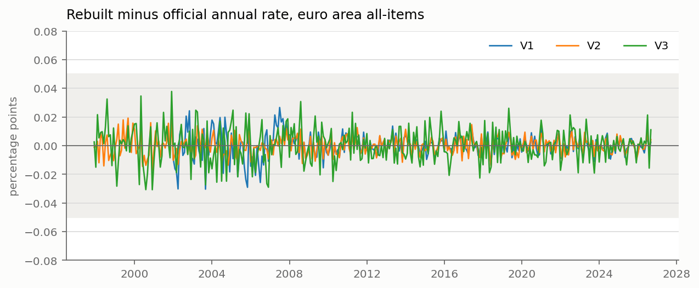
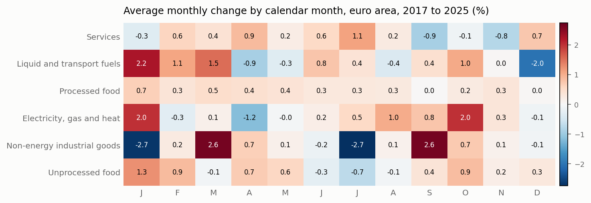
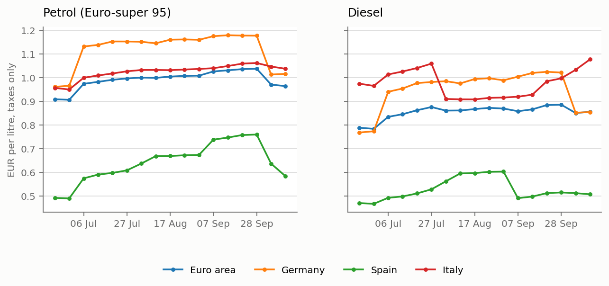
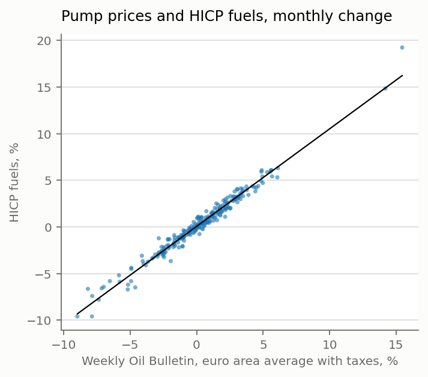

# QA findings

Built by `make qa` from silver and `data/gold/validation.json`.

## Validation

Largest gap 0.038 pp against a 0.05 pp limit. What's left is rounding: the official indices only have two decimals.

| gate | check | result | max gap (pp) | since 2017 (pp) | months |
|---|---|---|---|---|---|
| V1 | euro area rebuilt from the 6 main groups | pass | 0.030 | 0.014 | 298 |
| V2 | euro area rebuilt from the 13 COICOP divisions | pass | 0.019 | 0.015 | 346 |
| V3 | euro area rebuilt from the 21 national indices | pass | 0.038 | 0.026 | 346 |
| V3b | euro area rebuilt two levels deep (groups within countries) | pass | 0.032 | 0.019 | 298 |
| V3c | euro area rebuilt two levels deep (divisions within countries) | pass | 0.026 | 0.015 | 346 |
| V4 | contributions match Eurostat's published contributions | pass | 0.009 |  | 297 |
| V5 | Eurostat data is current | pass |  |  |  |

## Breaks

Before 2017 the special aggregates (the six groups, energy, food, core) are flagged d: back-calculated to the ECOICOP 2 definitions. January 2017 is flagged as a break in the same series. All-items and the 13 divisions carry no d flag. Full tables in `data_quality.md`.

Do the 2017 break or the switch to ECOICOP 2 in January 2026 show up in the monthly rates? January change against the usual January (median and MAD since 2002):

| group | January | m/m % | usual January % | robust z |
|---|---|---|---|---|
| Services | 2017 | -0.74 | -0.32 | -1.30 |
| Services | 2026 | -0.38 | -0.32 | -0.20 |
| Liquid and transport fuels | 2017 | 3.71 | 1.34 | 0.80 |
| Liquid and transport fuels | 2026 | 1.04 | 1.34 | -0.10 |
| Processed food | 2017 | 0.22 | 0.37 | -0.60 |
| Processed food | 2026 | 0.45 | 0.37 | 0.30 |
| Electricity, gas and heat | 2017 | 1.41 | 1.61 | -0.20 |
| Electricity, gas and heat | 2026 | 0.62 | 1.61 | -0.80 |
| Non-energy industrial goods | 2017 | -3.46 | -2.41 | -0.80 |
| Non-energy industrial goods | 2026 | -2.36 | -2.41 | 0.00 |
| Unprocessed food | 2017 | 1.96 | 1.05 | 3.50 |
| Unprocessed food | 2026 | 1.51 | 1.05 | 1.80 |

Above |z| = 3: unprocessed food 2017 (z 3.5). That lines up with the vegetable shortage in Spain that winter, so I treat it as a real price move. The rest look like normal Januaries, so monthly rates are fine across both breaks.

## Seasonality

The data isn't seasonally adjusted and it shows. Every September services drop (-0.91% on average since 2017, summer prices ending) and non-energy goods jump (+2.61%, end of the sales).

Biggest change in any calendar month, 2005-16 against 2017-25 (pp):

| group | max shift (pp) |
|---|---|
| Services | 0.73 |
| Liquid and transport fuels | 2.82 |
| Processed food | 0.34 |
| Electricity, gas and heat | 1.24 |
| Non-energy industrial goods | 0.38 |
| Unprocessed food | 0.66 |

Energy moves most (liquid and transport fuels 2.8 pp), mostly noise from big price swings. Of the rest, services 0.7 pp. Worth estimating on a rolling window rather than the full history.

Services in March and April by where Easter fell, 2002-25 (average m/m %):

|  | March | April |
|---|---|---|
| Easter in March | 0.39 | 0.06 |
| Easter in April | 0.22 | 0.55 |

Easter moves about 0.5 pp of services inflation between March and April, so the services model gets an Easter dummy.

## Fuel taxes and the October nowcast

Tax per litre from the Weekly Oil Bulletin (with-tax minus without-tax price):

| geo | product | 07 Sep | 14 Sep | 21 Sep | 28 Sep | 05 Oct | 12 Oct | change |
|---|---|---|---|---|---|---|---|---|
| DE | diesel | 1.004 | 1.020 | 1.024 | 1.021 | 0.852 | 0.854 | -0.150 |
| DE | euro95 | 1.175 | 1.179 | 1.178 | 1.177 | 1.013 | 1.016 | -0.159 |
| ES | diesel | 0.491 | 0.497 | 0.512 | 0.515 | 0.512 | 0.507 | 0.016 |
| ES | euro95 | 0.738 | 0.747 | 0.757 | 0.759 | 0.636 | 0.583 | -0.155 |
| EUR | diesel | 0.858 | 0.866 | 0.884 | 0.886 | 0.850 | 0.855 | -0.002 |
| EUR | euro95 | 1.026 | 1.031 | 1.036 | 1.038 | 0.970 | 0.964 | -0.062 |
| FR | diesel | 0.984 | 0.989 | 1.005 | 1.003 | 1.000 | 0.996 | 0.012 |
| FR | euro95 | 1.043 | 1.052 | 1.060 | 1.059 | 1.059 | 1.059 | 0.016 |
| IT | diesel | 0.919 | 0.928 | 0.984 | 0.997 | 1.033 | 1.077 | 0.158 |
| IT | euro95 | 1.040 | 1.049 | 1.059 | 1.062 | 1.047 | 1.037 | -0.002 |
| NL | diesel | 0.982 | 0.991 | 1.006 | 0.996 | 0.993 | 0.989 | 0.007 |
| NL | euro95 | 1.276 | 1.270 | 1.273 | 1.276 | 1.270 | 1.275 | -0.001 |

Weekly moves of 3 cents or more, last 16 weeks:

| country | fuel | week of | cents per litre |
|---|---|---|---|
| Germany | diesel | 06 Jul | +17 |
| Germany | diesel | 05 Oct | -17 |
| Germany | petrol | 06 Jul | +17 |
| Germany | petrol | 05 Oct | -16 |
| Spain | diesel | 03 Aug | +3 |
| Spain | diesel | 10 Aug | +3 |
| Spain | diesel | 07 Sep | -11 |
| Spain | petrol | 06 Jul | +8 |
| Spain | petrol | 10 Aug | +3 |
| Spain | petrol | 07 Sep | +6 |
| Spain | petrol | 05 Oct | -12 |
| Spain | petrol | 12 Oct | -5 |
| Euro area | diesel | 06 Jul | +5 |
| Euro area | diesel | 05 Oct | -4 |
| Euro area | petrol | 06 Jul | +7 |
| Euro area | petrol | 05 Oct | -7 |
| Italy | diesel | 06 Jul | +5 |
| Italy | diesel | 03 Aug | -15 |
| Italy | diesel | 21 Sep | +6 |
| Italy | diesel | 05 Oct | +4 |
| Italy | diesel | 12 Oct | +4 |
| Italy | petrol | 06 Jul | +5 |

The tax includes VAT, so a few cents can just be VAT following the pre-tax price. A step like Germany's 17 cents (diesel, week of 06 Jul) is an excise change; VAT can't move that much in a week. The HICP is measured with taxes, so these go straight into the fuel index whatever crude does.

Bulletin against HICP fuels, monthly change since 2006 (249 months): slope 1.05, intercept 0.06, R² 0.97, residual sd 0.54 pp.

2 bulletins of October so far (to 12 Oct): pump prices -1.7% on the September average, which puts HICP fuels at about -1.7% for October.

