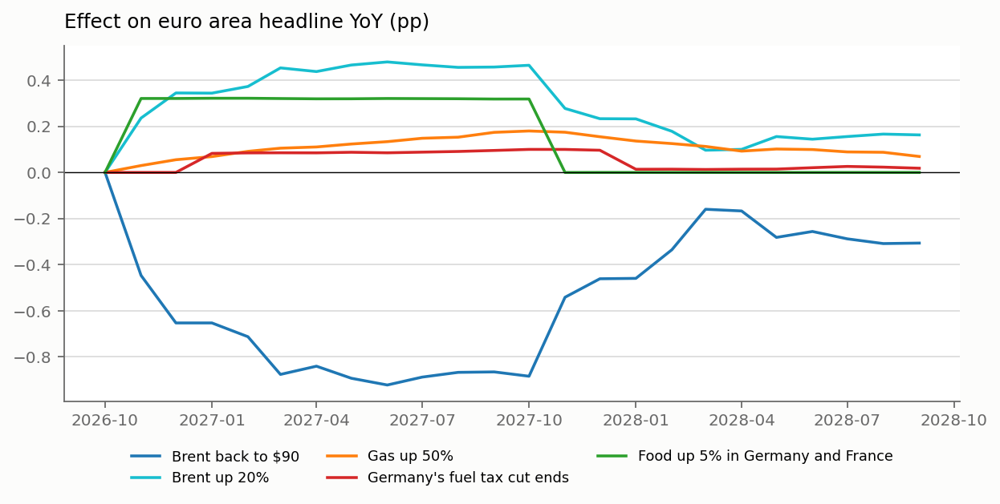

# Shock presets

Change in euro area headline YoY (pp) against the baseline: the forecast to Dec 2026, then each country's components on their usual seasonal path. Pass-through estimated without 2020-23; the last column uses the full sample, where second-round effects are stronger.

| preset | Dec 2026 | Dec 2027 | 2027 avg | of which indirect | peak | 2027 avg, like 2022 |
|---|---|---|---|---|---|---|
| Brent back to $90 | -0.65 | -0.46 | -0.78 | -0.06 | -0.92 in Jun 27 | -0.99 |
| Brent up 20% | +0.34 | +0.23 | +0.41 | +0.03 | +0.48 in Jun 27 | +0.51 |
| Gas up 50% | +0.06 | +0.15 | +0.13 | +0.01 | +0.18 in Oct 27 | +0.25 |
| Germany's fuel tax cut ends | +0.00 | +0.10 | +0.09 | +0.01 | +0.10 in Oct 27 | +0.11 |
| Food up 5% in Germany and France | +0.32 | +0.00 | +0.27 | +0.00 | +0.32 in Feb 27 | +0.27 |

- **Brent back to $90**: From $127, the average of the first half of October.
- **Brent up 20%**: To $153.
- **Gas up 50%**: Wholesale gas in euro; retail electricity and gas follow over a year or more.
- **Germany's fuel tax cut ends**: Weekly Oil Bulletin: tax per litre fell 16.7 cents on 05 Oct 2026. Undoing it on a pump price of 2.24 EUR/l, from 2027-01. FUEL also holds heating oil, so this is the upper end.
- **Food up 5% in Germany and France**: Illustrative; food and non-alcoholic beverages only.

